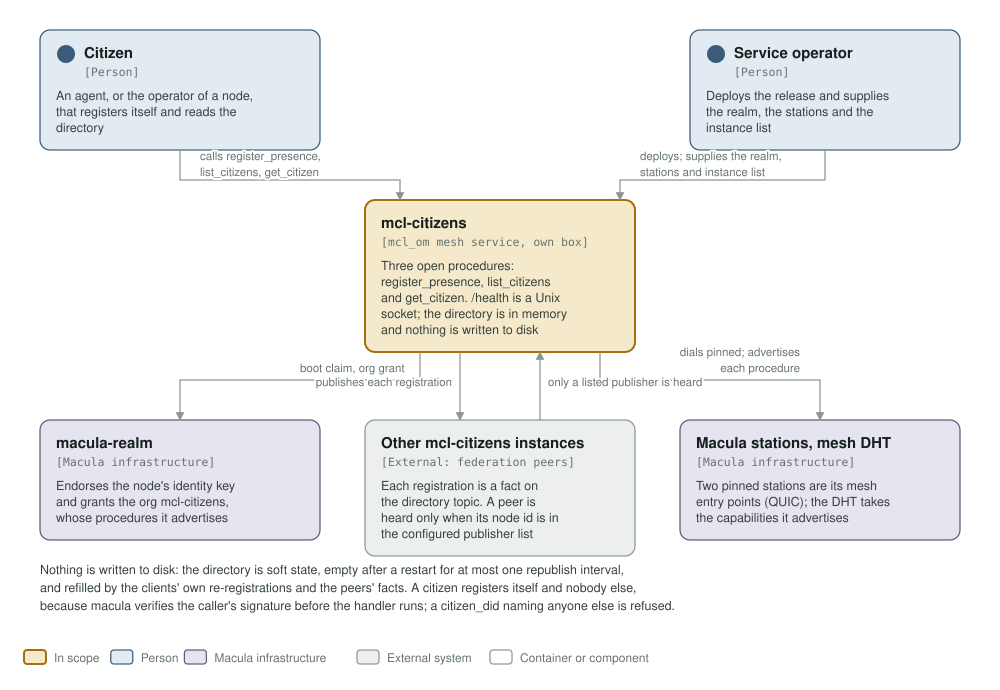
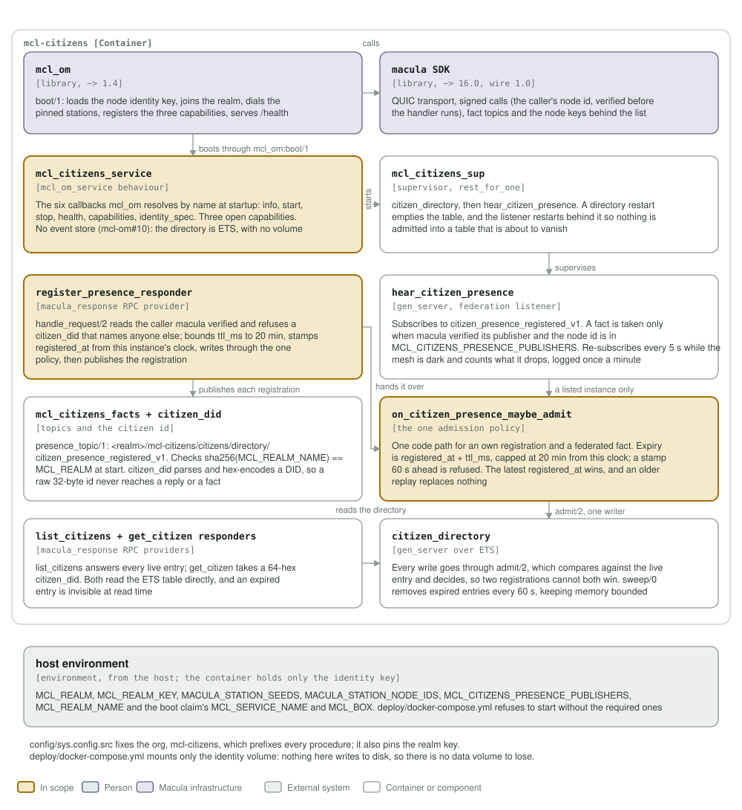

# mcl-citizens architecture: C4 model

*This exists so a reader can see what mcl-citizens talks to, and what it is made
of, without reading it.*

**Status: one soft-state directory, federated by fact.** One OTP release in one
container. `register_presence`, `list_citizens` and `get_citizen` are the
service's own procedures, and the only ones; `mcl-om` adds `<org>/info` and
`<org>/get_limits` to every service, both open, and `capabilities/0` is the
list. It answers `/health` on a Unix socket, holds the directory in ETS,
and federates every registration to the other instances as a mesh fact. It opens
no store and mounts no data volume.

## Level 1: system context

| Element | Kind | Role |
| --- | --- | --- |
| mcl-citizens | In scope | Serves `mcl-citizens/register_presence`, `mcl-citizens/list_citizens` and `mcl-citizens/get_citizen`, and `/health` on `/run/mcl/health.sock`. One `mcl_om` mesh service in one container |
| Citizen | Person | An agent, or the operator of a node, that registers itself (its verified caller id is its identity) and reads the directory |
| Service operator | Person | Deploys the release and supplies `MCL_REALM`, `MCL_REALM_KEY`, `MACULA_STATION_SEEDS` with `MACULA_STATION_NODE_IDS`, `MCL_REALM_NAME` and the federation instance list |
| macula-realm | Macula infrastructure | Endorses the node's identity key and grants the org `mcl-citizens`, which is what lets its procedures be advertised |
| Macula stations, mesh DHT | Macula infrastructure | The service dials out to the stations from the environment (QUIC, `pq_hybrid`); the mesh DHT takes the capabilities it advertises |
| Other mcl-citizens instances | External system | Peers on the directory topic: each hears the others' `citizen_presence_registered_v1`, but only from the node ids in `MCL_CITIZENS_PRESENCE_PUBLISHERS` |

The directory is soft state. Nothing is written to disk: a restart empties the
table and it refills from the clients' own re-registrations (about every five
minutes) and the peers' facts. A citizen registers itself and nobody else,
because macula verifies the caller's signature before the handler runs; a
`citizen_did` naming anyone else is refused with `citizen_did_is_not_the_caller`.

## Level 2: containers and components

| Component | Technology | Responsibility |
| --- | --- | --- |
| `mcl_citizens_service` | Erlang, the `mcl_om_service` behaviour | The six callbacks `mcl_om` resolves by name: `info/0`, `start/1`, `stop/1`, `health/0`, `capabilities/0`, `identity_spec/0`. `capabilities/0` lists the service's own procedures; `identity_spec/0` asks for scope `mcl-citizens` with no actions and no resources |
| `mcl_citizens_sup` | supervisor, `rest_for_one` | `citizen_directory`, then `hear_citizen_presence`. A directory restart empties the table, so the listener restarts behind it rather than admit into a table that is about to vanish |
| `register_presence_responder` | `macula_response` RPC provider | Reads the verified caller, refuses a `citizen_did` that names another, bounds `ttl_ms` to 20 minutes, stamps `registered_at` from this instance's clock, writes through the one policy, then publishes the registration |
| `hear_citizen_presence` | `gen_server`, the federation listener | Subscribes to `citizen_presence_registered_v1` and takes a fact only when macula verified its publisher and the node id is in `MCL_CITIZENS_PRESENCE_PUBLISHERS`. Re-subscribes every 5 s while the mesh is dark; counts what it drops and logs the count once a minute |
| `on_citizen_presence_maybe_admit` | the one admission policy | One code path for an own registration and a federated fact: expiry is `registered_at + ttl_ms`, capped at 20 minutes from this clock, and a stamp 60 s ahead is refused. The latest `registered_at` wins and an older replay replaces nothing |
| `citizen_directory` | `gen_server` over one ETS table | Every write goes through `admit/2`, which compares against the live entry and decides, so two registrations cannot both win. `sweep/0` removes expired entries every 60 s |
| `list_citizens` + `get_citizen` responders | `macula_response` RPC providers | `list_citizens` answers every live entry; `get_citizen` takes a 64-hex `citizen_did`. Both read ETS directly, and an expired entry is invisible at read time |
| `mcl_citizens_facts` + `citizen_did` | topics and the citizen id | `presence_topic/1` is `<realm>/mcl-citizens/citizens/directory/citizen_presence_registered_v1`, and the realm name is checked against `MCL_REALM` at start. `citizen_did` parses and hex-encodes a DID so a raw 32-byte id never reaches a reply or a fact |
| `mcl_om` | library, `~> 1.6` | `boot/1`: loads the node identity key, joins the realm, dials the stations from the environment, registers the declared capabilities and serves `/health`. It opens no store (mcl-om#10) |
| macula SDK | library, `~> 18.0`, wire 1.0 | QUIC transport, signed calls (the caller's node id, verified before the handler runs), app fact topics and the node keys behind the publisher list |
| host environment | from the host | `MCL_REALM`, `MCL_REALM_KEY`, `MACULA_STATION_SEEDS`, `MACULA_STATION_NODE_IDS`, `MCL_REALM_NAME`, `MCL_CITIZENS_PRESENCE_PUBLISHERS`, and the claim labels `MCL_SERVICE_NAME` and `MCL_BOX` |

`config/sys.config.src` fixes the org, `mcl-citizens`, which prefixes its own
procedures, and pins the realm key. The identity key is
the only thing on disk, at `/etc/mcl/secrets/identity.key`; `deploy/docker-compose.yml`
mounts `mcl-citizens-secrets` there and nothing else. `/health` is `down` without
the directory and `degraded` while the federation subscription is not held, which
includes a dark mesh.

**Where the station list comes from.** It is not in `config/sys.config.src`: `mcl_om` reads `MACULA_STATION_SEEDS` and `MACULA_STATION_NODE_IDS` from the environment at boot, paired index for index, so this repository pins no station and the list may be any length.

## Drawing them

`assets/c4-context.svg` and `assets/c4-components.svg` are generated by
`architecture/c4_diagrams.py` (`python3 architecture/c4_diagrams.py`), from the
code and never from this page: the callbacks in `mcl_citizens_service.erl`, the
three responders and the policy, `citizen_directory.erl` and
`hear_citizen_presence.erl`, the dependencies in `rebar.config`, the environment
in `config/sys.config.src` and `deploy/docker-compose.yml`. When one of those
changes, the diagram changes in the same commit.

Two rules for the files themselves, so they render everywhere they are read
(GitHub, an IDE, `rsvg-convert`): self-contained SVG, and literal colours in plain
classes plus a `prefers-color-scheme` dark block, never CSS custom properties,
which `rsvg-convert` renders black. The generator refuses to write a box that is
too small for its own text or a line wider than its box, so a stale box fails the
run rather than overlapping the next one.

The check that keeps them here is the `c4-model` job in
`.github/workflows/c4-model.yml`. It is red until both files exist and are
shown, and it stays red if either one goes missing.
